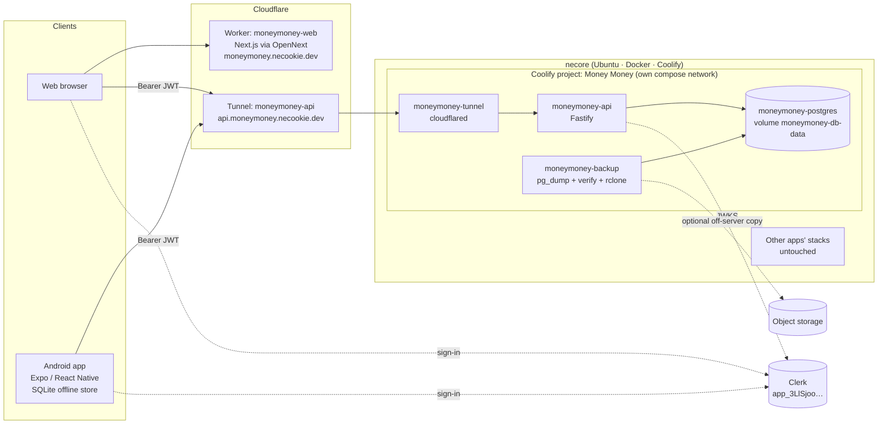

# System architecture

## Topology



- The **web app** renders on Cloudflare Workers (OpenNext adapter). It talks to the API from the
  browser with a Clerk session token; it holds no database credentials.
- The **API** is reachable publicly only through a **dedicated Cloudflare Tunnel** that runs as a
  container inside the Money Money stack. No host ports are published; the shared Coolify proxy,
  shared tunnels, SSH, Coolify admin and Postgres are never exposed.
- **Postgres** sits on an `internal: true` network shared only with the API and the backup sidecar.

## API — modular monolith

```text
apps/api/src/
  app.ts            buildApp(): plugins, security, OpenAPI, route registration (no I/O)
  server.ts         env, DB pool, Clerk verifier, graceful shutdown
  migrate.ts        advisory-locked migrations (run before every start)
  config/env.ts     Zod-validated environment
  plugins/          auth (Clerk + owner allow-list + user provisioning), errors (envelope)
  lib/              mappers (row ↔ DTO), snapshot (loads a user's finances for the engine), csv
  modules/<name>/   routes.ts · service.ts · repository.ts per bounded area:
                    settings, accounts, categories, transactions, scheduled-events, budgets,
                    goals, forecasts, alerts, dashboard, sync, demo, health
```

Request flow: `onRequest` auth hook → Zod validation (fastify-type-provider-zod) → route →
service/repository (every query filtered by `user_id`) → Zod response serialization → error
envelope `{ error: { code, message, requestId, details? } }`.

The **finance engine** (`packages/finance-engine`) is pure TypeScript with no I/O. The API loads a
snapshot (accounts, transactions, events, overrides, budgets, goals) and hands it to the engine,
so forecasts are reproducible and testable in isolation. The same engine runs on web and mobile
for formatting and lightweight local calculations.

## Data ownership & integrity

- Every table carries `user_id`; child rows reference parents with **composite `(id, user_id)`
  foreign keys**, so even a buggy query cannot link records across users.
- Transaction ids are **client-generated UUIDs** → idempotent creates and safe offline retries.
- A partial unique index allows a planned occurrence to be realised by **at most one** live
  transaction (no double counting between plan and actual).
- Money is `BIGINT` centavos; check constraints mirror business rules (amount sign, transfer shape).

## Scaling note

Forecasts load a user's full transaction list into memory. For a single private user this is
thousands of rows and well under 50 ms; if volumes ever grow 100×, replace `loadSnapshot` balance
computation with SQL aggregates (balances as of a date) — the engine API already supports passing
pre-aggregated opening balances.

## Isolation on `necore`

See [ADR 0002](../decisions/0002-isolated-coolify-stack.md) and
[Coolify deployment](../deployment/coolify.md). Money Money can be deployed, restarted, backed up
and removed without touching any other application. Shared physical risks remain (disk, power,
hardware) — hence off-server backups.
